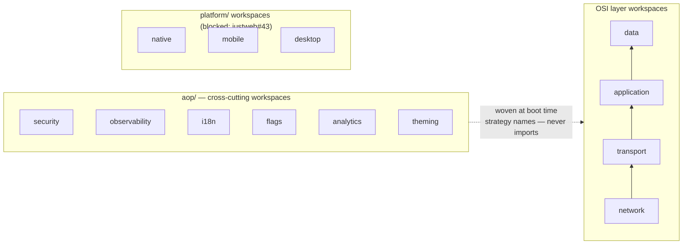
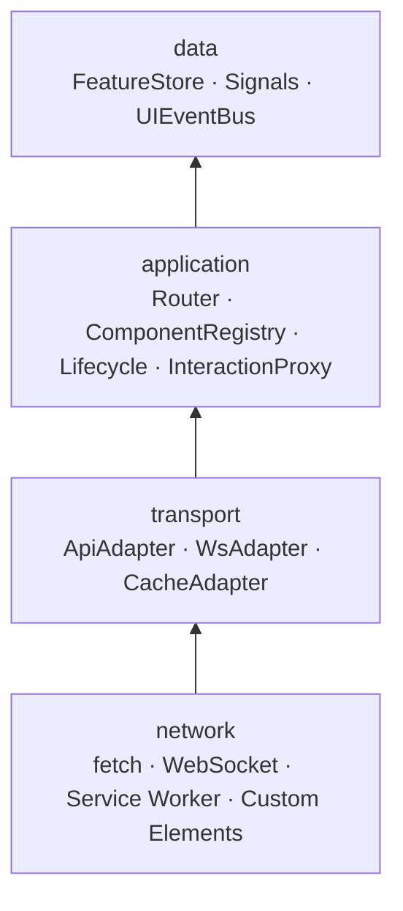
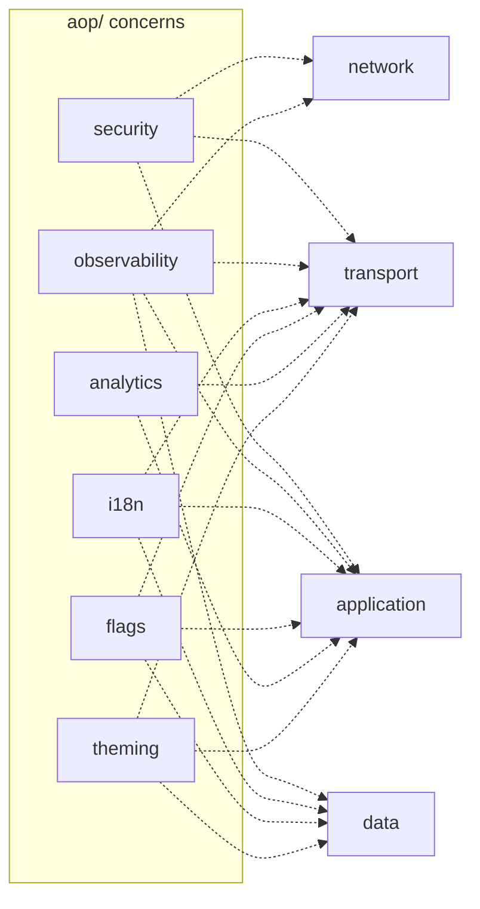
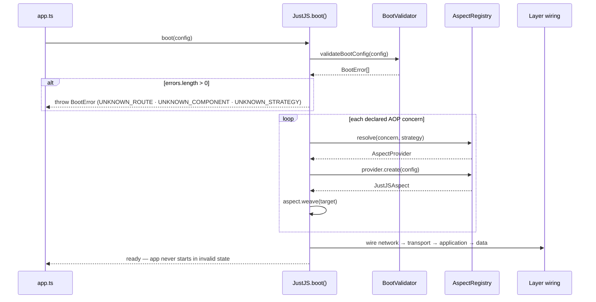
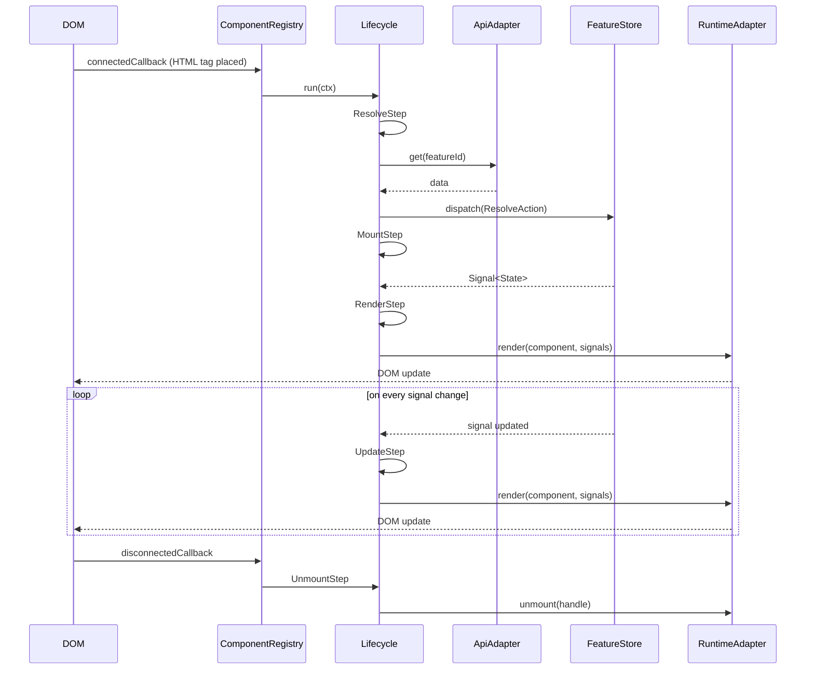
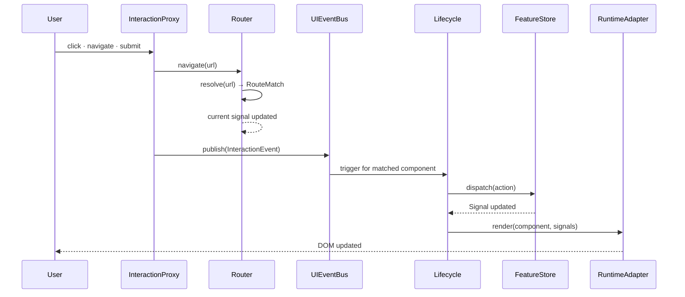
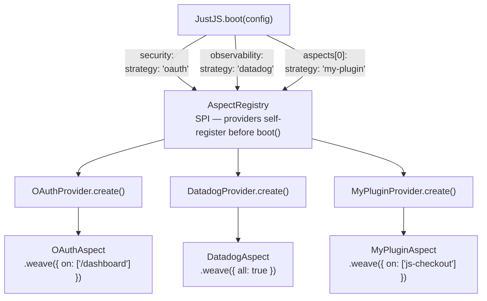
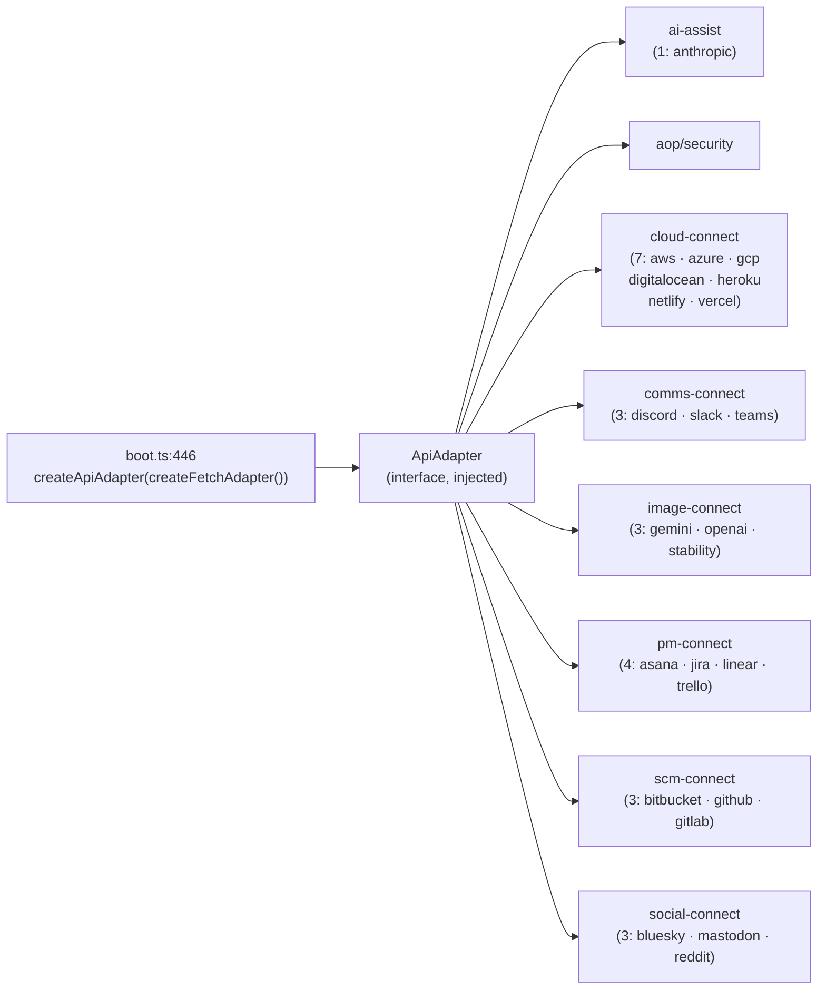
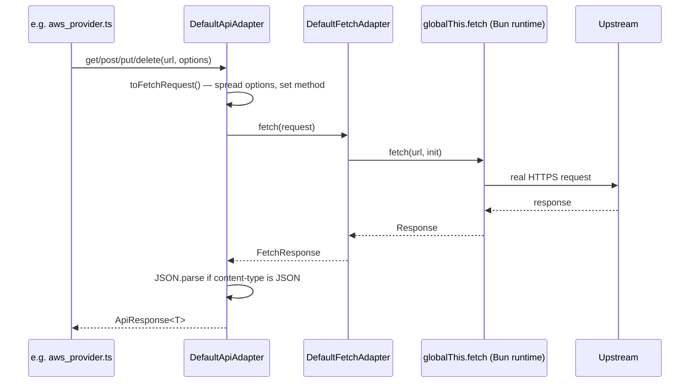
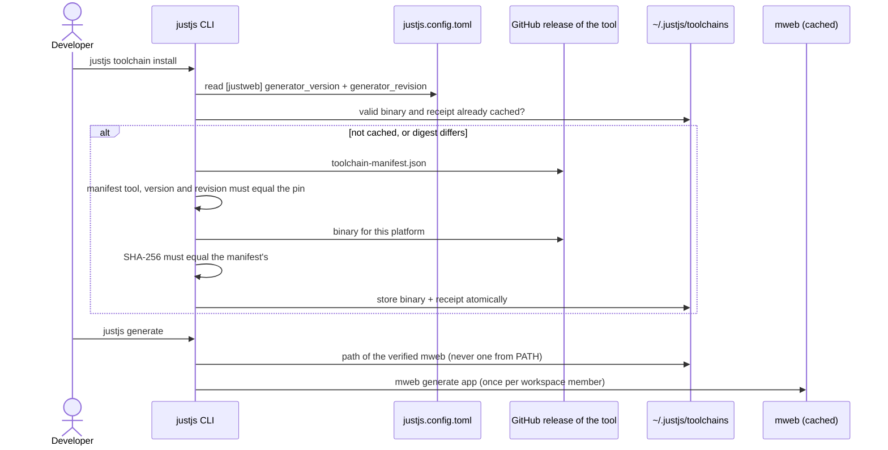

# JustJS — Architecture

Repository names: the framework is `sweengineeringlabs/justweb`, the MachineWeb
generator (`mweb`) is `sweengineeringlabs/machineweb`, and the `justjs` CLI is
`sweengineeringlabs/justweb-dev`. Package names and configuration filenames remain
unchanged. See [pinned toolchain](#pinned-toolchain) for the current versions.

## Overview

JustJS is the UI domain layer. The developer writes a `*_component.yaml` and places an HTML tag. Everything else flows — routing, auth, state, API transport, lifecycle, CSS, observability, platform delivery.

**Core principle:** all wiring is declared at boot time by strategy name, resolved through SPI, never by direct import. Swap a strategy name — nothing else changes.

---

## Workspace structure

Every layer, every AOP concern, and every platform adapter is a **standalone workspace** — installable, buildable, testable, and runnable in complete isolation. `bun-workspace.yaml` at the repo root is a convenience only; nothing depends on it to function.



```
justjs/
  network/scm/main/src/{api,core,saf,spi}
  transport/scm/main/src/{api,core,saf,spi}
  application/scm/main/src/{api,core,saf,spi}
  data/scm/main/src/{api,core,saf,spi}

  aop/
    security/scm/main/src/{api,core,saf,spi}
    observability/scm/main/src/{api,core,saf,spi}
    i18n/scm/main/src/{api,core,saf,spi}
    flags/scm/main/src/{api,core,saf,spi}
    analytics/scm/main/src/{api,core,saf,spi}
    theming/scm/main/src/{api,core,saf,spi}

  platform/
    native/scm/main/src/{api,core,saf,spi}    blocked: justweb#43
    mobile/scm/main/src/{api,core,saf,spi}    blocked: justweb#43
    desktop/scm/main/src/{api,core,saf,spi}   blocked: justweb#43

  docs/
  bun-workspace.yaml
  package.json
```

---

## Layer model

Modelled on the OSI stack — each layer has a single responsibility and depends only on layers below it. Data flows upward from `network` to `data`.



`application/` is the consumer-facing layer — what developers plug and play into the system. The framework concerns (security, observability, i18n, flags, analytics, theming) do not live here; they are woven from outside.

---

## AOP — cross-cutting concerns

A concern lives in `aop/` when it must **operate at more than one layer**. Placing it inside a single layer would either leak implementation upward or force other layers to depend on concerns they should not know about — violating the OSI constraint.

| Concern | network | transport | application | data |
|---|---|---|---|---|
| security | token refresh | auth headers | route guards | — |
| observability | request timing | call logs | lifecycle events | state change tracking |
| i18n | — | locale file loading | render-time translation | locale state |
| flags | — | config fetch | component / route gating | flag state |
| analytics | — | event dispatch | interaction capture | — |
| theming | — | token file loading | CSS application | theme state |

Each concern is declared at boot time by strategy name, resolved through the SPI `AspectRegistry`, and woven onto its targets. No layer imports an AOP concern directly.



Errors are **not** an AOP concern — each layer's `api/` defines its own specific error types.

---

## SAF — Service Abstraction Framework

Every workspace follows the same four-directory layout under `scm/main/src/`:

| Directory | Name | Role |
|---|---|---|
| `api/` | Contracts | Interfaces, errors, types — zero dependencies |
| `core/` | Implementations | Business logic — never imported by consumers |
| `saf/` | Service Abstraction Facade | Sole public export surface |
| `spi/` | Service Provider Implementation | Extension hooks — providers self-register here |

Consumers import only from a workspace's `saf/` surface. The `core/` implementations are an internal detail.

---

## Boot sequence



Boot-time validation is a hard invariant: every route path and component tag in `.on([])` / `.except([])` is validated against `routes.gen.json` and `registry.gen.ts` before any layer starts. Unknown target = `BootError`.

---

## Component lifecycle



---

## User interaction — data flow



---

## Aspect weaving — SPI



Third-party strategies are separate repos that self-register before `JustJS.boot()` is called. The consumer never imports the strategy implementation.

---

## Outbound network — composition root and real consumers

`ApiAdapter`/`FetchAdapter` (the `transport`/`network` interfaces above) are constructed exactly once, at `application/scm/main/src/core/boot.ts:446`:

```ts
this._apiAdapter = config.apiAdapter ?? createApiAdapter(createFetchAdapter())
```

Every real consumer depends only on the `ApiAdapter` **type**, injected at construction time — none of them import `DefaultApiAdapter`/`DefaultFetchAdapter` directly. Swapping the composition root's implementation changes nothing for any consumer below.



### Outbound call sequence — real, current (git HEAD, not the v4 interim proxy)



This runs entirely on Bun today — no `edge-bootstrap` involvement, no compiled Wasm. `justjs#155` tracks retiring this composition root's implementation in favor of `edge-bootstrap` infra; the ~30 consumers above are unaffected by that swap since they only depend on the `ApiAdapter` interface.

---

## Pinned toolchain

JustJS applications are generated and checked by tools that live in other repositories. A
project does not use whatever versions happen to be installed: it **pins** them, and the
`justjs` CLI installs, verifies and runs exactly those.



What is pinned, and where:

| Pin | Value | Declared in | Enforced by |
|---|---|---|---|
| `mweb` version and source commit | `0.5.0` @ `9035afa17bca513bcfd3e3081ae0fcba26df902e` | `[justweb] generator_version` / `generator_revision` in each example's `justjs.config.toml` | `bun run check:docs`: all examples agree, CI builds the generator from that very commit, docs state the same |
| `csslense`, `browsectl` | optional `[csslense]` / `[browsectl]` sections, same `version` + `revision` form | `justjs.config.toml` | the CLI; not used by the examples here |
| `justjs` CLI | built from source in CI at `sweengineeringlabs/justweb-dev` commit `0445fffadd71f69504d35a909d178994b08685dc` | `.github/workflows/ci.yml` (`ref:`) | `bun run check:docs`: docs that name a `justweb-dev` commit match it |
| Rust (to build the CLI and the generator) | `1.99.1` | `dtolnay/rust-toolchain@1.99.1` in `ci.yml` | `bun run check:docs` |
| Bun | `1.4.2` | `packageManager` and `bun-version` in `ci.yml` | CI verifies `bun --version`; `bun run check:docs` |

The three tools are released from their own repositories (`machineweb`, `csslense`, `browsectl`),
not from `justweb-dev` (ADR-0024 describes where the CLI crate lives). A tool release carries
a `toolchain-manifest.json` listing each platform's binary and its SHA-256; the CLI refuses a
manifest whose tool, version or revision differs from the pin, or that lacks the host platform.
The `mweb` 0.5.0 release currently carries a Windows x86_64 binary only, so CI validates
regeneration from the pinned source on Linux, and on Windows builds the CLI and runs the
downloaded `mweb` release through the example workflows.

A commit used as a CI checkout ref must be on the other repository's `main`, not the tip of a
branch that may later be deleted: a ref that no longer exists fails the checkout. The
failure modes and fixes are in the [runbook](../7-operations/runbook.md#pinned-toolchain-failures),
and the re-pin procedure is in the [playbook](../7-operations/playbook.md#re-pin-the-toolchain).

## Interface inventory

Interfaces are organised by the workspace they belong to. Each workspace's `api/` also defines its own error types.

### network/

| Interface | File |
|---|---|
| `RuntimeAdapter` | `api/runtime.ts` |

### transport/

| Interface | File |
|---|---|
| `ApiAdapter` | `api/transport.ts` |
| `WsAdapter`, `WsConnection` | `api/transport.ts` |
| `CacheAdapter` | `api/transport.ts` |

### application/

| Interface | File |
|---|---|
| `Component<Props, State, Events>` | `api/api_component.ts` |
| `ComponentContext` | `api/api_component.ts` |
| `MountHandle` | `api/api_component.ts` |
| `LifecycleStep`, `Lifecycle` | `api/api_lifecycle.ts` |
| `LifecycleEvent`, `LifecycleEventType` | `api/api_lifecycle.ts` |
| `Route`, `RouteMatch`, `Router` | `api/router.ts` |
| `ComponentRegistry` | `api/router.ts` |
| `InteractionProxy`, `InteractionEvent` | `api/router.ts` |
| `JustJSAspect`, `AspectProvider`, `AspectRegistry` | `api/api_aspect.ts` |
| `AspectTarget`, `AspectConfig`, `AspectDeclaration` | `api/api_aspect.ts` |
| `BootConfig`, `BootError` | `api/api_boot.ts` |
| `RoutesManifest`, `RegistryManifest`, `ImportMap` | `api/api_boot.ts` |

### data/

| Interface | File |
|---|---|
| `Signal<T>`, `WritableSignal<T>` | `api/store.ts` |
| `FeatureStore<T, Selector>` | `api/store.ts` |
| `Action`, `UIEventBus`, `UIEvent` | `api/store.ts` |

### aop/security/

| Interface | File |
|---|---|
| `Principal`, `UISecurityContext` | `api/security.ts` |
| `RouteGuard` | `api/security.ts` |

### aop/observability/

| Interface | File |
|---|---|
| `UIObserverContext`, `LogDrain` | `api/observer.ts` |

### aop/i18n/

| Interface | File |
|---|---|
| `I18nContext` | `api/i18n.ts` |

### aop/flags/

| Interface | File |
|---|---|
| `FlagsContext` | `api/flags.ts` |

### aop/analytics/

| Interface | File |
|---|---|
| `AnalyticsContext` | `api/analytics.ts` |

### aop/theming/

| Interface | File |
|---|---|
| `UIThemingContext`, `ThemingProviderConfig`, `ThemingAspect`, `ThemingProvider` | `api/api_provider.ts` |
